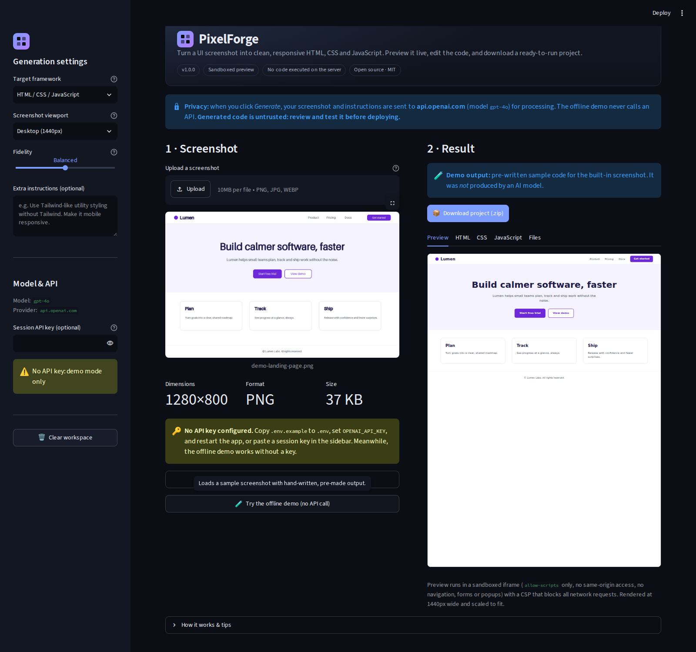

# PixelForge: screenshot → code

Upload a screenshot of a website or UI, let a vision model analyse it, then **preview, edit and download** a
responsive HTML / CSS / JavaScript project.

PixelForge now runs in three ways:

| Mode | Best for | Install | API key |
|---|---|---|---|
| **Standalone HTML** | The quickest look; sharing one file | Download `pixelforge.html` and open it | Your own key |
| **Browser extension** | Daily use; avoids page CORS restrictions | Load the folder as an unpacked extension | Your own key |
| **Python / Streamlit** | Local development and the original app | `make setup && make run` | Your own key or `.env` |

No PixelForge server is involved in the browser versions. Screenshots and API keys go only to the model provider
you configure. The **offline demo** needs no key and makes no network calls.



*The original Python/Streamlit interface. The standalone browser app and extension use the same workflow.*

## Features

- Drag-and-drop PNG, JPG/JPEG and WebP upload with local validation and downscaling
- Viewport, fidelity and free-text instructions
- OpenAI-compatible vision API support, with your own key and optional custom base URL
- Offline demo with a sample screenshot and hand-written output
- Sandboxed live preview, editable HTML / CSS / JavaScript, and per-file downloads
- One-click ZIP export containing the project and a README
- No frontend build step, framework or CDN dependencies
- Optional Python/Streamlit version with Pydantic validation and an automated test suite

React export is **not** implemented yet. The UI only offers what works.

---

## Option 1: Standalone browser app (single HTML file)

This is the simplest way to try PixelForge. `pixelforge.html` contains the entire UI, CSS, JavaScript and preview
sandbox in one file.

### Download and open it

1. On the GitHub page for this repository, click **Code → Download ZIP**.
2. Extract the ZIP.
3. Double-click **`pixelforge.html`** (or drag it into a browser tab).

That is it. You can also keep `pixelforge.html` on a USB drive or send it to someone else.

> **API calls from `file://`:** some providers, including some OpenAI-compatible servers, reject browser requests
> from a `file://` page because of CORS. If generation fails with a connection/CORS error, use the extension or
> serve the folder over HTTP as shown below.

### Publish it with GitHub Pages

The repository root is already a static site (`index.html`, `styles.css`, `app.js`, `preview.html`).

1. Fork or push the repository to GitHub.
2. Open **Settings → Pages**.
3. Under **Build and deployment**, choose **Deploy from a branch**.
4. Select your default branch and the **`/ (root)`** folder, then save.
5. Open the URL GitHub shows, for example `https://YOUR-USERNAME.github.io/pixelforge/`.

The root version loads its files separately. The single-file `pixelforge.html` is still available for direct
download from the repository.

### Run it locally from source

```bash
git clone <your-fork-url> pixelforge
cd pixelforge
make serve
# open http://localhost:8000
```

Without `make`:

```bash
python3 -m http.server 8000
```

There is no npm install or build step. To create a fresh single-file build after editing the source:

```bash
make web
# or: python3 scripts/build_web.py
```

This regenerates `pixelforge.html`.

---

## Option 2: Browser extension

The extension is a regular Manifest V3 extension. Chromium browsers are the primary target; the manifest also
includes Firefox background-script settings as a best effort.

### Chrome or Edge

1. Download the repository ZIP and extract it. You need the **whole folder**, not just `index.html`.
2. Open `chrome://extensions` (or `edge://extensions`).
3. Turn on **Developer mode**.
4. Click **Load unpacked**.
5. Select the folder that contains `manifest.json` (the project root).
6. Pin **PixelForge** if you want quick access, then click its toolbar icon.

The app opens in a full browser tab. Clicking the icon again focuses the existing PixelForge tab when possible.

After editing extension files, return to `chrome://extensions` and click the reload button on the PixelForge card,
then reload the app tab.

### Firefox (temporary/experimental)

1. Download and extract the repository.
2. Open `about:debugging#/runtime/this-firefox`.
3. Click **Load Temporary Add-on…**.
4. Select `manifest.json` from the extracted folder.

Temporary add-ons disappear when Firefox restarts. Permanent self-distribution requires signing through Mozilla.
Chromium-based browsers are the most thoroughly tested path.

### What the extension permissions mean

- **`storage`** remembers the PixelForge tab ID.
- **`clipboardWrite`** supports the Copy buttons.
- **`https://api.openai.com/*`** lets the extension call OpenAI without page CORS restrictions.
- **Optional `https://*/*` and `http://*/*`** are requested only when you use a custom API base URL.
- A custom host permission is requested the first time you press **Generate code** with that base URL.

The extension does not read your browsing history, inject scripts into other websites, or send data to a
PixelForge server.

---

## Option 3: Python / Streamlit app

The original Streamlit version remains in this repository. It needs **Python 3.11+**.

### macOS / Linux

```bash
git clone <your-fork-url> pixelforge && cd pixelforge
make setup                  # creates .venv, installs dependencies, creates .env
# edit .env and set OPENAI_API_KEY (optional: the demo works without it)
make run                    # opens http://localhost:8501
```

Without `make`:

```bash
python3 -m venv .venv
source .venv/bin/activate
pip install -r requirements.txt
cp .env.example .env
streamlit run app.py
```

### Windows (PowerShell)

```powershell
py -3.11 -m venv .venv
.venv\Scripts\Activate.ps1
pip install -r requirements.txt
Copy-Item .env.example .env
streamlit run app.py
```

If activation is blocked: `Set-ExecutionPolicy -Scope Process -ExecutionPolicy Bypass`.

### Configuration

All Streamlit settings come from environment variables or `.env` (see [`.env.example`](.env.example)).

| Variable | Default | Purpose |
|---|---|---|
| `OPENAI_API_KEY` | – | API key. You can also paste a session-only key in the sidebar. |
| `PIXELFORGE_MODEL` | `gpt-4o` | Any vision-capable chat model available to your account. |
| `PIXELFORGE_BASE_URL` | OpenAI | Optional OpenAI-compatible endpoint. |
| `PIXELFORGE_TOKEN_PARAM` | `max_completion_tokens` | Set to `max_tokens` for servers that need the older name. |
| `PIXELFORGE_TIMEOUT_SECONDS` | `120` | Per-request timeout. |
| `PIXELFORGE_MAX_OUTPUT_TOKENS` | `16000` | Output budget; raise it for large pages. |
| `PIXELFORGE_MAX_UPLOAD_MB` | `10` | Upload limit (also set in `.streamlit/config.toml`). |
| `PIXELFORGE_MAX_SEND_SIDE` | `2000` | Longer side is downscaled to this before sending. |

---

## Using the browser app

1. **Upload a screenshot.** PNG, JPG or WebP, up to 10 MB. Larger images are downscaled locally before sending.
   The offline demo does not call any API.
2. **Choose settings.** Pick the viewport the screenshot was captured at, a fidelity level, and any styling or
   structure preferences.
3. **Add model details.**
   - **API key:** required for AI generation.
   - **Model:** any vision-capable OpenAI-compatible chat model.
   - **API base URL:** leave blank for OpenAI (`https://api.openai.com/v1`). For another provider, enter its
     OpenAI-compatible base URL, for example `http://localhost:11434/v1`.
4. **Generate code.** The model returns structured JSON. PixelForge validates paths and sizes, removes external
   resources and unsafe embeds, then shows the result.
5. **Preview, edit and export.** Code tabs update the live preview when edited. The ZIP includes a README and all
   current file contents.

### API keys and “Remember this key”

- The key is sent **directly from your browser to the API host** in the `Authorization` header.
- If **Remember this key on this device** is checked, the key is stored in this origin’s `localStorage`. It is not
  synced and is not sent to PixelForge.
- If unchecked, the key stays in the current tab’s memory only.
- Clearing site data, using a different browser profile, or choosing another origin removes it.
- Treat browser profiles as sensitive: any extension or person with access to the profile may be able to read
  stored keys.

### Custom API hosts and CORS

The standalone page calls the provider with `fetch`. The provider must allow browser requests (CORS) from the page’s
origin. Many local inference servers need an explicit CORS flag. In the extension, Chrome can bypass page CORS for a
host after you grant the optional permission.

The browser app attempts `POST {baseURL}/chat/completions` with an OpenAI-compatible body. It starts with
`response_format: {"type":"json_object"}` and `max_completion_tokens`; if a provider rejects one of those, it retries
without JSON mode or with `max_tokens`.

---

## Security model

Generated code is **untrusted input**.

- **Sandboxed preview.** Generated pages run inside nested `sandbox="allow-scripts"` iframes without
  `allow-same-origin`. They cannot read the PixelForge page, cookies or storage.
- **Restrictive CSP.** The preview document injects a policy that allows inline CSS/JS and inert `data:` media,
  while blocking network access, forms, top navigation and framing.
- **Sanitising.** Unsafe paths, duplicate or oversized files, external scripts/styles/media, iframes, objects,
  embeds, `<base>`, meta-refresh and `javascript:` links are removed or neutralised. Risky JavaScript is flagged
  for review.
- **No server execution.** The browser versions never execute generated code on a server. The Streamlit preview is
  also sandboxed and CSP-restricted.
- **No PixelForge backend.** The browser app and extension do not upload screenshots or keys to this project.
- **Extension permissions.** Custom API hosts require an explicit optional host permission.

### Limitations

- Visual reconstruction is approximate: fonts, exact colours, photos, hover states and hidden content cannot be
  recovered reliably from a screenshot.
- Edits made in the code tabs are **not re-sanitised**. The preview stays sandboxed and the ZIP revalidates paths
  and sizes, but you should review any generated code before deploying it.
- The sanitiser is defence in depth, not a replacement for code review.
- Browser support for extension sandbox pages and optional host permissions varies. Chrome/Edge are the primary
  targets.
- API cost and latency depend on the model and image.

---

## Project structure

```text
index.html                  Browser app shell
styles.css                  Browser app styles
app.js                      Browser app logic (upload, API, sanitiser, preview, editor, ZIP)
preview.html                Sandboxed preview bridge
pixelforge.html             Generated single-file browser app
manifest.json               Manifest V3 extension
background.js               Opens/focuses the extension tab
icons/                      Extension icons
scripts/build_web.py        Builds pixelforge.html
app.py                      Streamlit entry point
pixelforge/                 Python generation, validation, preview and export modules
tests/                      Python test suite
docs/                       Screenshots
```

The browser app has no third-party frontend dependencies. The ZIP exporter is implemented in `app.js` with a
store-only ZIP writer and CRC32.

---

## Development and tests

```bash
make web                 # rebuild pixelforge.html
make serve               # serve the browser app at http://localhost:8000
node --check app.js      # syntax-check the browser app
make test                # Python test suite; no API key or network needed
```

The Python suite covers image processing, schema and malformed responses, retries, API error translation, path and
ZIP safety, HTML/CSS sanitising, preview properties, workspace reset and Streamlit UI flows.

When changing the frontend, test these paths:

1. The offline demo in the single-file build and the extension.
2. The preview after switching viewport and after editing code.
3. ZIP download and per-file download.
4. A custom API base URL, if you have a test endpoint.
5. Extension reload after manifest or `preview.html` changes.

---

## Troubleshooting

| Symptom | Fix |
|---|---|
| API request fails with a connection/CORS error in `pixelforge.html` | Open the file via a local HTTP server or use the extension. The provider may not allow `file://` origins. |
| “The API key was rejected” | Check for stray spaces/quotes, confirm the key is active, and check the provider. |
| “Model … not found” or HTTP 404 | Confirm the model name and that the base URL includes the correct path, often `/v1`. |
| HTTP 429 / quota exhausted | Check billing and rate limits, then try again. |
| The preview is blank | Check the browser console. A malformed generated document or a very strict browser sandbox setting can prevent it. The offline demo is the quickest sanity check. |
| Preview looks clipped | Choose the correct screenshot viewport and reload the page after updating `styles.css`; the preview scales to fit its panel. |
| Extension icon opens nothing | Reload the extension at `chrome://extensions` and make sure `background.js`, `index.html` and `preview.html` are all in the loaded folder. |
| Custom host permission prompt does not appear | The base URL may not match the optional host patterns, or the permission was already denied. Reset the extension’s site permissions and try again. |
| Download ZIP does nothing | Check the browser’s download settings and pop-up/download blocking. |
| Copy does nothing | Clipboard access may require HTTPS, localhost or the extension context. Select the code manually as a fallback. |
| GitHub Pages shows 404 | Deploy from the repository root and make sure `index.html` is at the top level of the deployed branch. |
| `pixelforge.html` is stale after edits | Run `make web` again; the single file is generated, not loaded from the source files. |
| Streamlit: “No API key configured” | Create `.env` from `.env.example`, set `OPENAI_API_KEY`, and restart. Or use the offline demo. |
| Streamlit command missing | Activate `.venv` or run `python -m streamlit run app.py`. |
| Port 8501 busy | `streamlit run app.py --server.port 8600` |
| Port 8000 busy | `python3 -m http.server 8100` |

---

## Roadmap

- React (Vite) export with a proper scaffold
- Side-by-side visual diff between screenshot and rendered output
- Multi-screenshot / multi-page projects and “refine this section” prompts
- Additional providers behind the same generator interface

## Contributing

1. Fork and create a feature branch.
2. Keep browser-only code dependency-free unless there is a strong reason.
3. Run `make test`, `node --check app.js` and `make web` before opening a pull request.
4. Never commit real API keys, private screenshots or generated secrets.
5. Describe the change and any manual browser/extension testing in the pull request.

## License

MIT, see [LICENSE](LICENSE). Generated code is yours to use, but review it before deploying.
